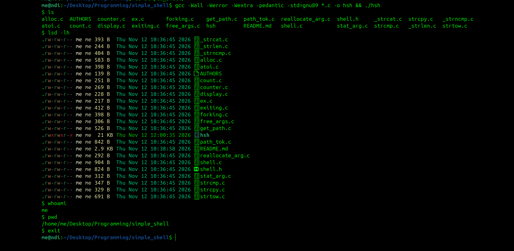

# simple_shell

A minimal UNIX command-line interpreter written in C, modelled on `/bin/sh`.
Built as the Simple Shell project of the ALX Software Engineering programme.

## Features

- Interactive mode with a `$ ` prompt, and non-interactive mode (commands piped from stdin)
- Runs commands by absolute path (`/bin/ls`) or by name, searched in `PATH` (`ls`)
- Passes arguments to commands (`ls -l /tmp`)
- Built-in `exit` and `exit <status>`
- Handles end-of-file (`Ctrl+D`) and prints an error for commands it can't find
- Its own string helpers (`_strlen`, `_strcat`, `_strcmp`, `_atoi`, …) instead of most of the standard library

## Requirements

- Linux or another UNIX-like OS
- `gcc`

## Compilation

```sh
gcc -Wall -Werror -Wextra -pedantic -std=gnu89 *.c -o hsh
```

## Usage

**Demo**



**Interactive mode**

```sh
$ ./hsh
$ ls -l
total 104
-rw-rw-r-- 1 user user  583 Nov 12 10:36 alloc.c
...
$ /bin/pwd
/home/user/simple_shell
$ exit
```

**Non-interactive mode**

```sh
$ echo "ls" | ./hsh
alloc.c  atoi.c  AUTHORS  ...
$ cat commands.txt | ./hsh
```

## How it works

1. `prompt()` prints `$ ` when stdin is a terminal.
2. `getline()` reads a line, and `strtow()` splits it into words.
3. `exiting()` handles the `exit` built-in.
4. If the command doesn't start with `/`, `path_tok()` builds a candidate path for each `PATH` directory, and `stat_arg()` picks the first one that exists.
5. `forking()` forks. The child runs the program with `execve()` and the parent waits for it.
6. The argument arrays are freed and the loop starts again.

## Project structure

| File | Description |
|------|-------------|
| `shell.c` | Entry point and main read–execute loop |
| `shell.h` | Header with includes and prototypes |
| `display.c` | `prompt` – prints the prompt in interactive mode |
| `strtow.c` | `strtow` – splits a line into words |
| `get_path.c` | `get_path` – reads an environment variable |
| `path_tok.c` | `path_tok` – builds full paths from `PATH` |
| `stat_arg.c` | `stat_arg` – returns the first path that exists |
| `reallocate_arg.c` | `reallocate_arg` – swaps a command name for its full path |
| `forking.c` | `forking` – forks and waits for the child |
| `ex.c` | `ex` – runs the command with `execve` |
| `exiting.c` | `exiting` – the `exit` built-in |
| `alloc.c` | `alloc` – allocates a 2D array of words |
| `free_args.c` | `free_args` – frees a 2D array |
| `count.c` | `count_args` – counts array entries |
| `counter.c` | `count` – measures the length of a word |
| `_strlen.c`, `_strcat.c`, `strcpy.c`, `strcmp.c`, `_strncmp.c`, `atoi.c` | String helpers |

## Limitations

- The only built-in is `exit` (no `env`, `cd`, `setenv`, …)
- No pipes, redirections, `;`, `&&`, `||`, variables or aliases

## Contributing

Contributions are welcome! Pick one of the open tasks below, or suggest your own.

### Known bugs

- **`exit <status>` crashes the shell.** Typing a command such as `exit 3` causes a segmentation fault. In `exiting.c`, `argv` is freed before `argv[1]` is read. Saving the status first fixes it:
  ```c
  int status = _atoi(argv[1]);
  free(line);
  free_args(argv, count_args(argv));
  exit(status);
  ```

### Feature ideas

- `env` built-in to print the environment
- `cd` built-in, with `cd -` and `cd` to `$HOME`
- `setenv` and `unsetenv` built-ins
- Command separator `;` and logical operators `&&` and `||`
- Variable replacement (`$?`, `$$`, `$PATH`)
- Comments (`#`)
- Running commands from a file (`./hsh script.sh`)
- First release tag (`v1.0.0`) once the bug above is fixed

### How to contribute

1. Fork the repository and create a branch: `git checkout -b fix-exit-status`
2. Make your changes and keep the [Betty](https://github.com/alx-tools/Betty) coding style.
3. Check that it still builds without warnings:
   ```sh
   gcc -Wall -Werror -Wextra -pedantic -std=gnu89 *.c -o hsh
   ```
4. Test it in interactive and non-interactive mode, and check for memory leaks with `valgrind ./hsh`.
5. Commit, push your branch and open a pull request that explains what you changed.

## Authors

- **Clement Mugisha** – <clmntmugisha@gmail.com>
- **Poli Ninshuti Ndiramiye** – <onlythenotes@gmail.com>

See [AUTHORS](AUTHORS). Our first project together, built between 1 and 16 November 2023.
